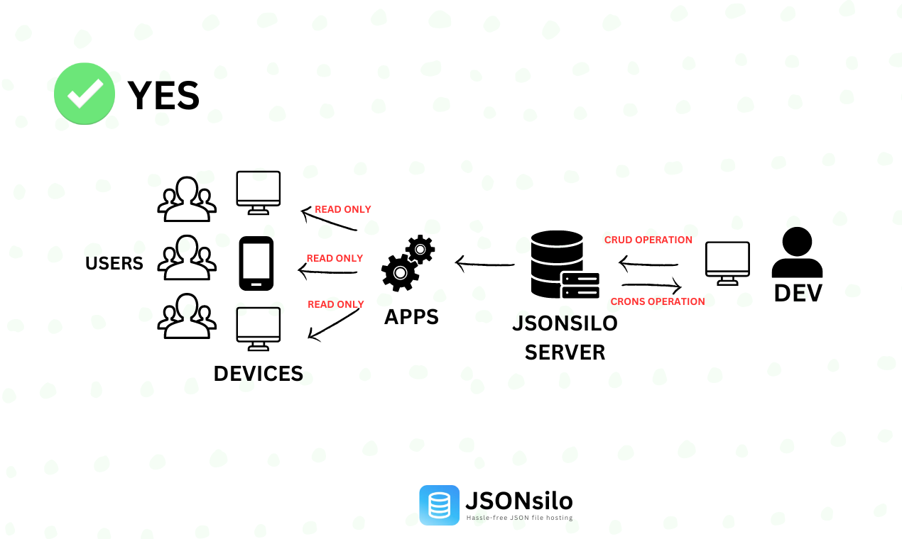
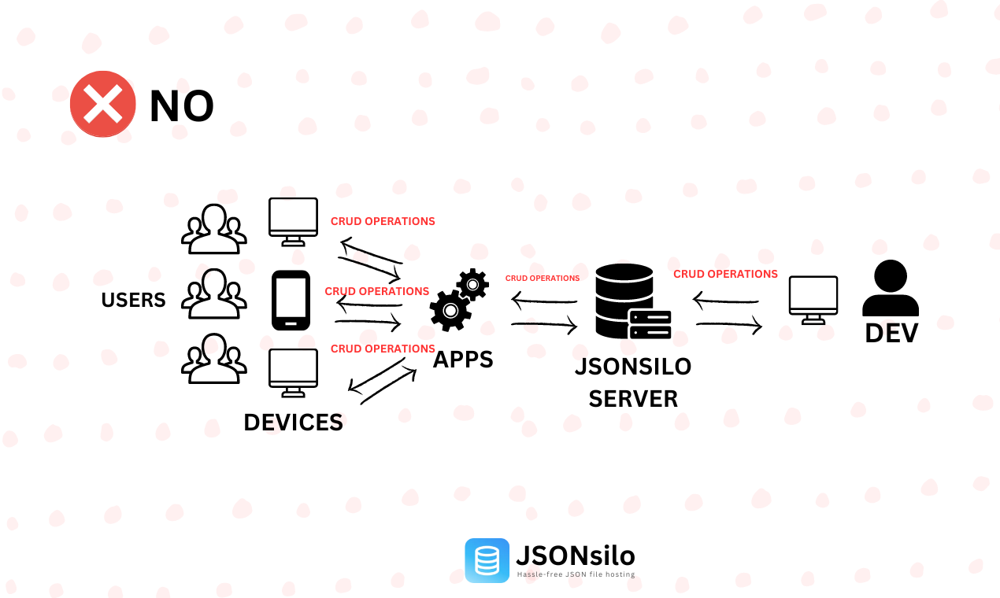

> ⚠️ **Warning**
>
> - This update process does not happen in real-time. It's not suitable for scenarios where **multiple users attempt to update data simultaneously**.
> - `file_data` replaces the silo's data completely. To change part of it, read the silo, modify the data, and send all of it back.
> - If the silo has a [locked schema](/features/schema-lock), `file_data` must match it. Otherwise the request returns `422` and nothing is saved.
> - Changing `region_name` or `is_public` changes the silo's URL.
>

---

