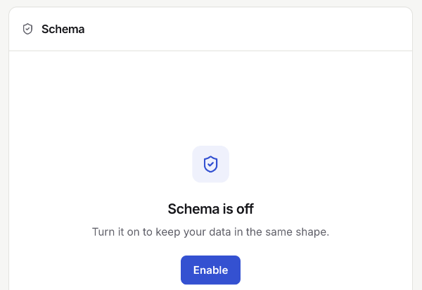
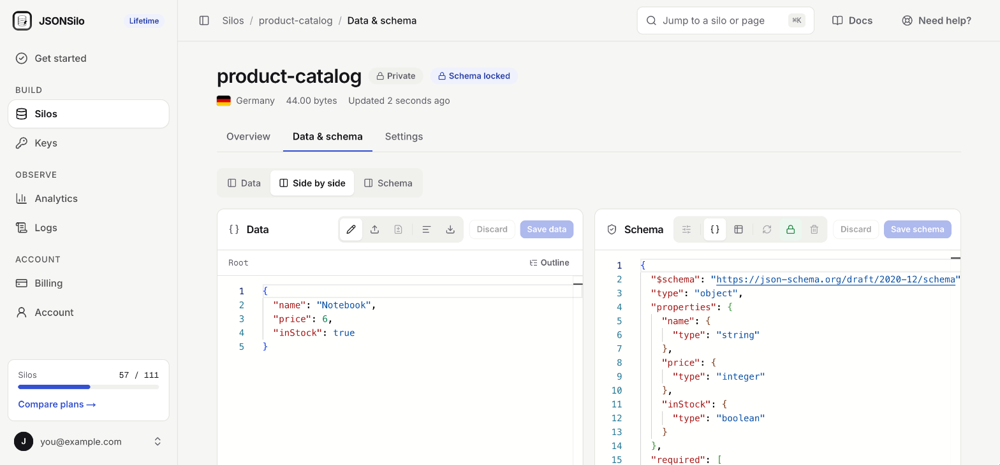

## Introduction

Schema lock lets you attach a [JSON Schema](https://json-schema.org) to a silo and **lock** it. While a silo is locked, any write that doesn't match the schema is rejected, and the stored data stays as it was.

The point is to protect the apps that read your silo. A bad edit or a buggy script can no longer change the shape of your data, so those apps never get data in a shape they don't expect.

> **Schema lock is included in the free trial and on the Basic and Pro plans.** See [Pricing Plans](/pricing-plans).

## How It Works

A silo's schema has two separate parts:

- **The schema**: A JSON Schema that describes the shape of the data.
- **The lock**: A switch that decides whether writes are checked against the schema.

| State | What it means |
|---|---|
| **No schema** | The silo accepts any valid JSON. |
| **Unlocked** | The schema is saved, but writes aren't checked. The data editor still flags data that doesn't fit. |
| **Locked** | Every write must match the schema, or it is rejected. |

Because the schema and the lock are separate, unlocking a silo keeps its schema. You can unlock, make a change, and lock again.

### Which writes are checked

While a silo is locked, the check applies to every way of replacing its data:

| Write | What happens when the data doesn't match |
|---|---|
| Saving in the console | The console won't save, and shows the invalid value. |
| [Update Silo](/api-reference/endpoint/patch-silo) in the Manage API | The request returns `422`. |
| `update_silo` and `patch_silo` over [MCP](/mcp/tools) | The tool returns an error that names the invalid value. |

Changes that don't touch the data, such as renaming a silo or changing its access or region, are never blocked.

<Note>A schema can only be managed in the console. The Manage API and MCP can read whether a silo is locked, but they can't change or remove a schema. The lock exists to stop automated writers, so they must not be able to loosen it.</Note>

## Enable a Schema

<Steps>
  <Step title="Open the Data & schema tab">
    Click **Silos** in the sidebar, open your silo, and click the **Data & schema** tab. The **Schema** pane is on the right.

    You can also get there from the **Schema lock** card on the silo's **Overview** tab by clicking `Create schema`.
  </Step>
  <Step title="Click Enable">
    While a silo has no schema, the pane shows **Schema is off**. Click `Enable`.

    JSONsilo generates a schema from the silo's current data and saves it **unlocked**, so nothing is rejected yet.

    <Frame></Frame>
  </Step>
  <Step title="Review the schema">
    Read through the generated schema and adjust it if you need to. The status at the bottom right of the pane shows **Valid data** when your current data matches the schema in the editor.

    Switch to the **Fields view** for a table of every field with its type and whether it is required.
  </Step>
  <Step title="Lock it">
    Click the lock button in the Schema pane's toolbar. The button turns green, and a **Schema locked** badge appears in the silo's header.

    From now on, every write must match the schema.

    <Frame></Frame>
  </Step>
</Steps>

<Note>You can't lock a schema while the silo's current data doesn't match it. Fix the data or the schema first.</Note>

## Strict and Loose Mode

The mode decides how a schema is generated from your data. Open the **Mode** menu in the Schema pane's toolbar to switch.

| Mode | What it accepts |
|---|---|
| **Strict** | Only the fields in your data today are accepted. |
| **Loose** | Existing fields must keep their types. New fields are accepted. |

`Enable` generates a strict schema. Switching mode regenerates the schema, which replaces what is in the editor.

A strict schema sets `"additionalProperties": false`, and a loose schema leaves it out. In both modes, a field is marked as required only when every object at that position has it.

### Example

Suppose your silo data looks like this:

```json data.json
{
  "name": "Blue T-shirt",
  "price": 19.99,
  "tags": ["cotton", "summer"]
}
```

A strict schema generated from it looks like this:

```json schema.json
{
  "$schema": "https://json-schema.org/draft/2020-12/schema",
  "type": "object",
  "properties": {
    "name": { "type": "string" },
    "price": { "type": "number" },
    "tags": {
      "type": "array",
      "items": { "type": "string" }
    }
  },
  "required": ["name", "price", "tags"],
  "additionalProperties": false
}
```

With this schema locked, a write that sets `price` to the string `"19.99"` is rejected, and so is a write that adds a `color` field. In loose mode, the `color` field would be accepted.

<Tip>A field whose values are all whole numbers is generated as `integer`. If it should also accept decimals, change its type to `number` before you lock.</Tip>

## Schema Pane Toolbar

1. **Mode:** Choose **Strict** or **Loose**. Switching regenerates the schema.
2. **JSON view / Fields view:** Edit the schema as JSON, or read it as a table of fields.
3. **Regenerate from data:** Builds a fresh schema from the data in the data editor, unsaved edits included. A dot on the button means the data no longer matches the schema.
4. **Lock:** Locks or unlocks the saved schema.
5. **Remove schema:** Deletes the schema. The silo accepts any JSON again, and its data doesn't change. Unlock the schema first.
6. **Discard:** Throws away your unsaved edits to the schema.
7. **Save schema:** Saves the schema in the editor. Saving keeps the lock as it is.

## Edit a Locked Schema

A locked schema is read-only. To change it:

<Steps>
  <Step title="Unlock">
    Click the lock button to unlock the schema. Writes are no longer checked.
  </Step>
  <Step title="Edit and save">
    Edit the schema, or click **Regenerate from data** to rebuild it, then click `Save schema`.
  </Step>
  <Step title="Lock again">
    Click the lock button. If you have unsaved edits, locking saves them in the same step.
  </Step>
</Steps>

## Write Your Own Schema

You don't have to use a generated schema. You can write or paste any JSON Schema in the editor.

### Supported drafts

Set `$schema` to choose a draft. Without a `$schema`, draft 2020-12 is assumed.

| Draft | `$schema` |
|---|---|
| Draft-04 | `http://json-schema.org/draft-04/schema#` |
| Draft-07 | `http://json-schema.org/draft-07/schema#` |
| 2019-09 | `https://json-schema.org/draft/2019-09/schema` |
| 2020-12 | `https://json-schema.org/draft/2020-12/schema` |

### Limits

A schema is checked when you save it. It must follow these rules:

- It must be a JSON object, at most **64 KB** in size and **32 levels** deep.
- `$ref` must point inside the same schema, for example `#/$defs/product`. Remote references are not supported.
- `$id` is only allowed at the root of the schema.
- `$dynamicRef` and `$recursiveRef` are not supported.
- Every `pattern` must be a valid regular expression of at most **512 characters**.

## Error Response

When a write through the Manage API doesn't match a locked schema, the request returns `422` and nothing is saved:

```json
{
  "message": "Silo data does not match its locked schema.",
  "errors": [
    {
      "path": "/products/1/price",
      "message": "Instance type \"string\" is invalid. Expected \"number\"."
    }
  ]
}
```

- `path`: A [JSON Pointer](https://datatracker.ietf.org/doc/html/rfc6901) to the invalid value. An empty path means the root of the document.
- `message`: Why the value is invalid.

> **Note:** The check stops at the first problem it finds, so `errors` contains one entry. Fix it and send the request again to find the next one.

## Plans and Downgrades

- **Setting, changing, and generating** a schema needs a plan that includes schema lock.
- **Removing** a schema is allowed on every plan.
- **Checking** writes against a locked schema applies on every plan.

If your plan changes to one without schema lock, an existing lock keeps protecting the silo until you remove the schema. A downgrade never silently drops a lock.
