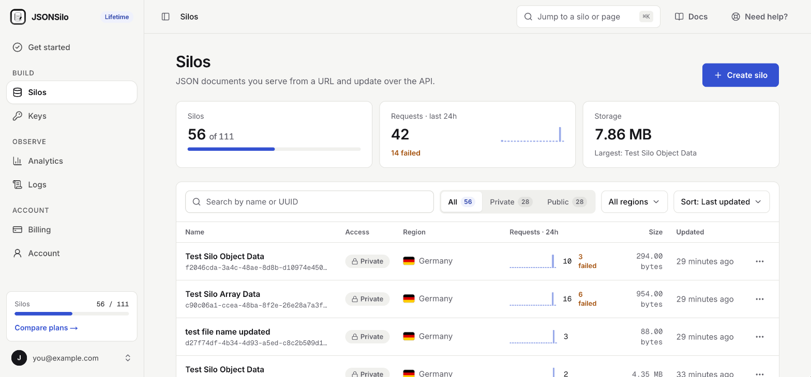
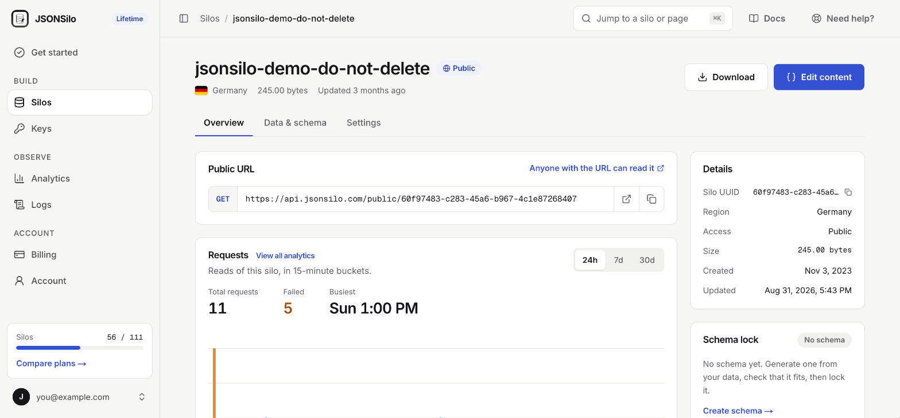
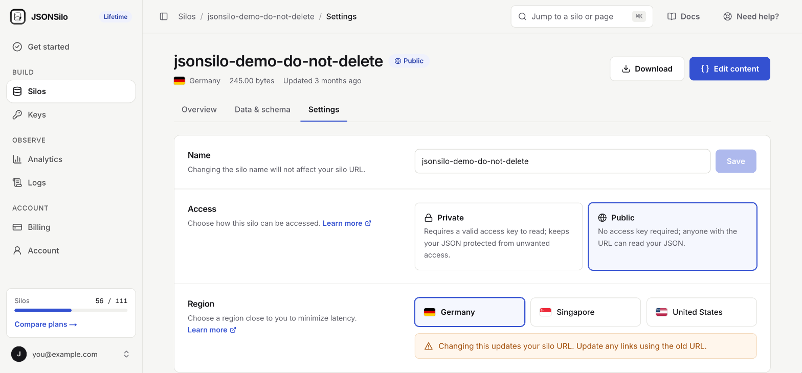

## Introduction

Managing a silo in JSONsilo allows you to access and modify your stored JSON files. This guide will walk you through the steps to manage an existing silo and access its contents.

## Find a silo

Click **Silos** in the sidebar. The screen opens with three usage tiles: how many silos you have out of your plan's limit, requests in the last 24 hours, and total storage.

<Frame></Frame>

Below the tiles, the list shows each silo's name, access, region, requests in the last 24 hours, size, and when it was last updated. To narrow it down:

- **Search**: Type a name or a UUID.
- **Access**: Show **All**, **Private**, or **Public** silos.
- **Region**: Show silos in one region.
- **Sort**: Order by **Last updated**, **Name**, **Size**, or **Requests**.

Each row has an actions menu with shortcuts: **Overview**, **Edit content**, **Copy URL**, **Copy UUID**, and **Settings**.

<Tip>Press `⌘K` on macOS or `Ctrl K` on Windows and Linux from any screen to jump straight to a silo by name or UUID.</Tip>

## Open a silo

Click a silo to open it. The header shows the silo's name, access type, region, size, and when it was last updated. A **Schema locked** badge appears when the silo's schema is locked.

Two buttons sit on the right of the header:

- `Download`: Saves the silo's JSON to your computer as a `.json` file.
- `Edit content`: Opens the **Data & schema** tab.

Below the header, three tabs organize everything about the silo.

### 1. Overview

<Frame></Frame>

1. **Silo URL**: The URL to read the silo, with a copy button. For a public silo the card is titled **Public URL**. For private silos, an Access Key is required.
2. **Requests**: A chart of the requests this silo served. See [Analytics](/features/analytics).
3. **Getting started**: Ready-to-run examples in cURL, JavaScript, and Python that already contain this silo's URL.
4. **Details**: The **Silo UUID**, **Region**, **Access**, **Size**, **Created**, and **Updated** values. Click the UUID to copy it.
5. **Schema lock**: Whether the silo has a schema and whether it is **Locked** or **Unlocked**. See [Schema Lock](/features/schema-lock).
6. **Data preview**: The first lines of the silo's JSON. Click `Open editor` to see all of it.

### 2. Data & schema

This tab is where you edit the silo's JSON and its JSON Schema, side by side.

For more details, check out our [Data & Schema Editor Documentation](/editor/json-editor).

### 3. Settings

This tab allows you to rename the silo, manage its access and region, and delete it.

<Frame></Frame>

1. **Name**: Type a new name and click `Save`. Changing the silo name will not affect your silo URL.

2. **Access**: Click **Private** or **Public** to switch the access type, then click `Confirm` in the dialog.

    <Warning>Switching access changes the silo URL. A public silo is read from `/public/[file-uuid]`, and a private silo from `/[file-uuid]`. Update any links using the old URL.</Warning>

3. **Region**: Click a region to move the silo there, then click `Confirm` in the dialog. Changing the region also updates your silo URL. See [Regions](/regions).

4. **Delete silo**: Click `Delete silo…` to remove the silo permanently. A confirmation dialog will appear; type the silo name to confirm deletion and click `Delete silo` to proceed. See [Delete Silo](/how-to/delete-silo).

That's it! You have successfully managed your silo in JSONsilo. ✨

## What's next?
- Learn how to [use the Data & Schema Editor to edit your JSON data.](/editor/json-editor) 
- Learn how to [Search data in your silo](/features/search-silo-data).
- Learn how to [Query data in your silo](/features/query-silo-data).
- Learn how to [lock a schema on your silo](/features/schema-lock).
