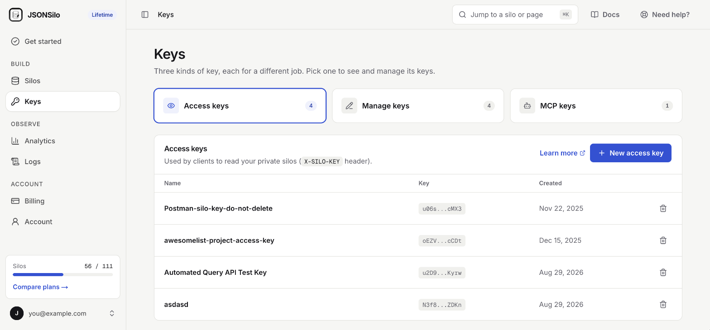

## What is an Access Key?

An Access Key is a unique identifier used to access private silos in JSONsilo. When you create a private silo, you need an Access Key to read its data. This ensures that only authorized users can access the silo's contents.

Send the key in the `X-SILO-KEY` header:

```bash Terminal
curl -X GET \
  -H 'X-SILO-KEY: <YOUR_X_SILO_KEY_HERE>' \
  https://[region-code].jsonsilo.com/[file-uuid]
```

An Access Key can read every private silo in your account. It can't create, update, or delete silos. For that, use a [Manage Key](/keys/manage-keys).

## How to Generate an Access Key

To generate a new Access Key, follow these steps:

<Steps>
  <Step title="Go to the Keys Page">
    Click **Keys** in the sidebar and select the **Access keys** card.

    <Frame></Frame>
  </Step>
  <Step title="Generate a New Access Key">
    Click the `New access key` button.
  </Step>
  <Step title="Set Key Details">
    In the dialog, enter a name for your Access Key so you can recognize it later, and click the `Create key` button.
  </Step>
  <Step title="Save the Access Key">
    The **Key created** dialog shows your key. Copy the Access Key and store it securely. You will need it to access your private silo.

    Tick **I've stored this key somewhere safe**, then click `Done`.

    <Warning>Copy the key now, as you won't be able to see it again!</Warning>
  </Step>
</Steps>

After that, the key is listed with its name, a shortened version of the key, and the date it was created.

## Deleting an Access Key

To delete an Access Key, follow these steps:

<Warning>Make sure nothing is still using the key. A deleted key stops working immediately, and any app that sends it will start receiving `401` errors.</Warning>

<Steps>
  <Step title="Go to the Keys Page">
    Click **Keys** in the sidebar and select the **Access keys** card.
  </Step>
  <Step title="Delete the Access Key">
    Find the Access Key you want to delete in the list and click the trash icon at the end of its row.
  </Step>
  <Step title="Confirm">
    In the **Delete this key?** dialog, click the `Delete` button. This action can't be undone.
  </Step>
</Steps>

## Errors

| Status | Meaning |
|---|---|
| `403` | The `X-SILO-KEY` header is missing. |
| `401` | The key is invalid or was deleted. |
| `404` | The silo doesn't exist, or it belongs to another account. |

## Best Practices for Managing Access Keys

- **Keep Your Access Keys Secret**: Treat your Access Keys like passwords. Do not share them publicly or expose them in client-side code.
- **Rotate Your Access Keys Regularly**: Periodically regenerate your Access Keys to minimize the risk of unauthorized access.
- **Use Environment Variables**: Store your Access Keys in environment variables instead of hardcoding them in your application.
- **Use One Key per App**: Give each app or service its own key, so you can delete one without breaking the others.
