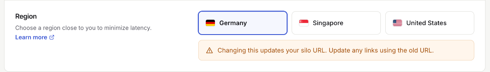

## Introduction

In this guide, we explain the concept of silo regions and region codes.

## Regions

JSONsilo is committed to delivering global availability, powering millions of requests daily to services and devices worldwide.

### Asia
| Region        | Code | Status       |
|---------------|------|--------------|
| Singapore     | `sg-01-api`   | Available    |
| Japan         | N/A   | Coming Soon  |
| India         | N/A   | Coming Soon  |
| Malaysia      | N/A   | Coming Soon  |

### Europe
| Region        | Code | Status       |
|---------------|------|--------------|
| Germany: Düsseldorf | `api` | Available |

### North America
| Region        | Code | Status       |
|---------------|------|--------------|
| United States: Central | `usc-01-api` | Available |
| United States: West    |  N/A    | Coming Soon |

## Region Base URLs

The region code is the first part of a silo's URL.

| Region | Code | Base URL |
|--------|------|----------|
| Germany | `api` | `https://api.jsonsilo.com` |
| Singapore | `sg-01-api` | `https://sg-01-api.jsonsilo.com` |
| United States | `usc-01-api` | `https://usc-01-api.jsonsilo.com` |

## Region Availability

All three regions are available during the free trial and on the Basic and Pro plans. Accounts on the legacy Free plan can use the Germany (`api`) region only. See [Pricing Plans](/pricing-plans).

## How to Change Silo Region

To change the region of your silo, follow these steps:

<Warning>Ensure there are no active requests when changing the region. Otherwise, you may receive a `404` error.</Warning>
<Warning>After updating the region, use the correct base URL for the selected region.</Warning>

<Steps>
  <Step title="Go to the Silos Page">
    Click **Silos** in the sidebar to view your list of silos. Select the silo you want to update by clicking its name.
  </Step>
  <Step title="Open the Settings Tab">
    On the silo page, click the **Settings** tab and find the **Region** setting.

    <Frame></Frame>
  </Step>

  <Step title="Select New Region">
    Click the region you want. A dialog asks you to confirm the move, for example **Move silo to Singapore?** Click `Confirm` to save your changes.

    <Danger>Changing this updates your silo URL. Update any links using the old URL.</Danger>
  </Step>
</Steps>

You can also change a silo's region through the Manage API by sending `region_name` in an [Update Silo](/api-reference/endpoint/patch-silo) request.
